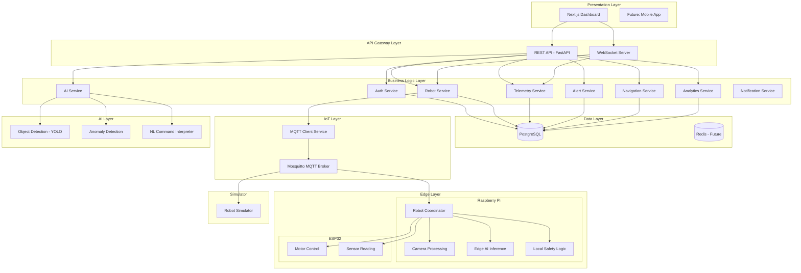
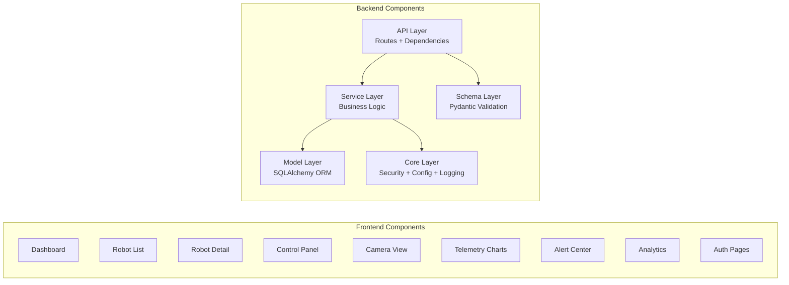
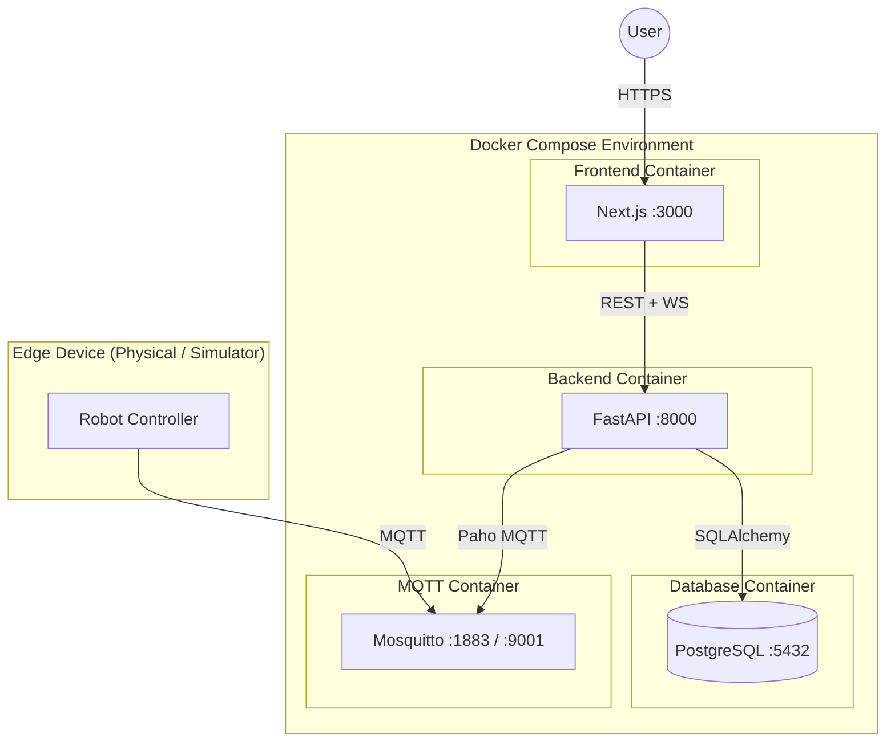
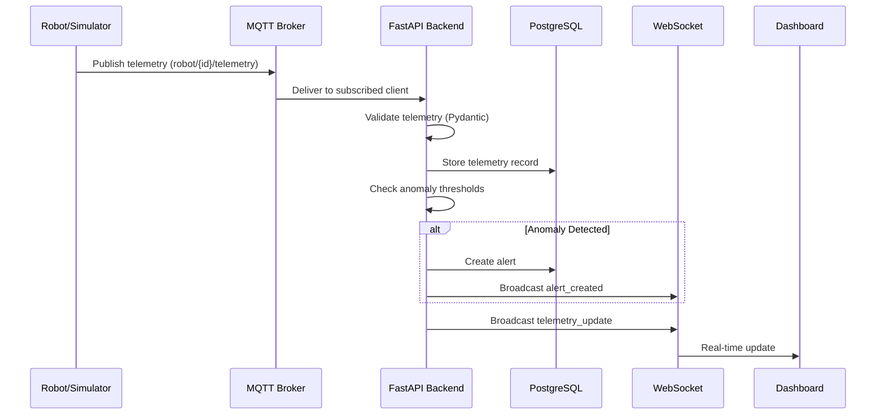
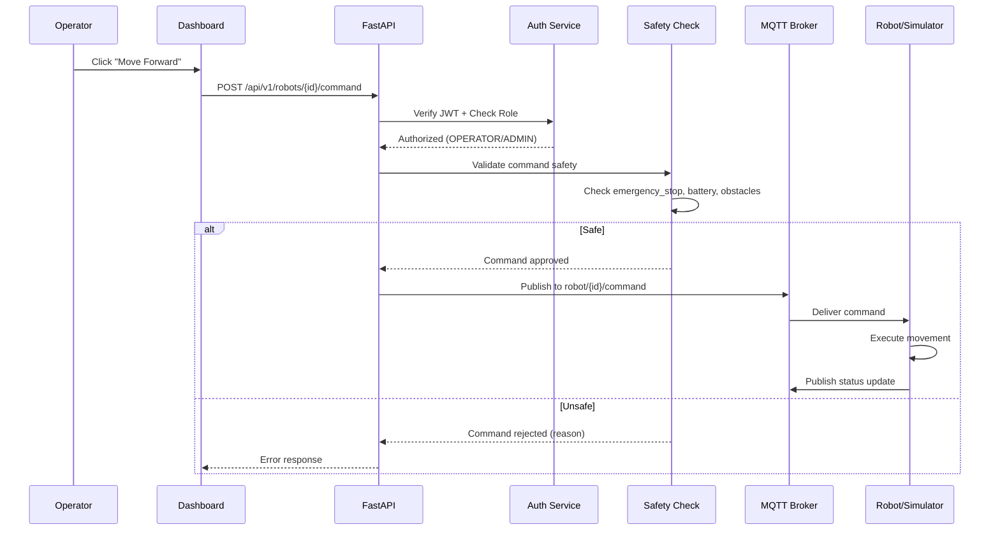
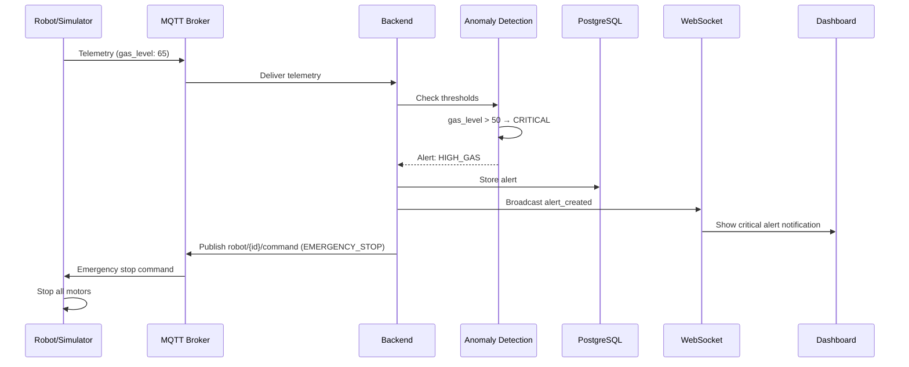
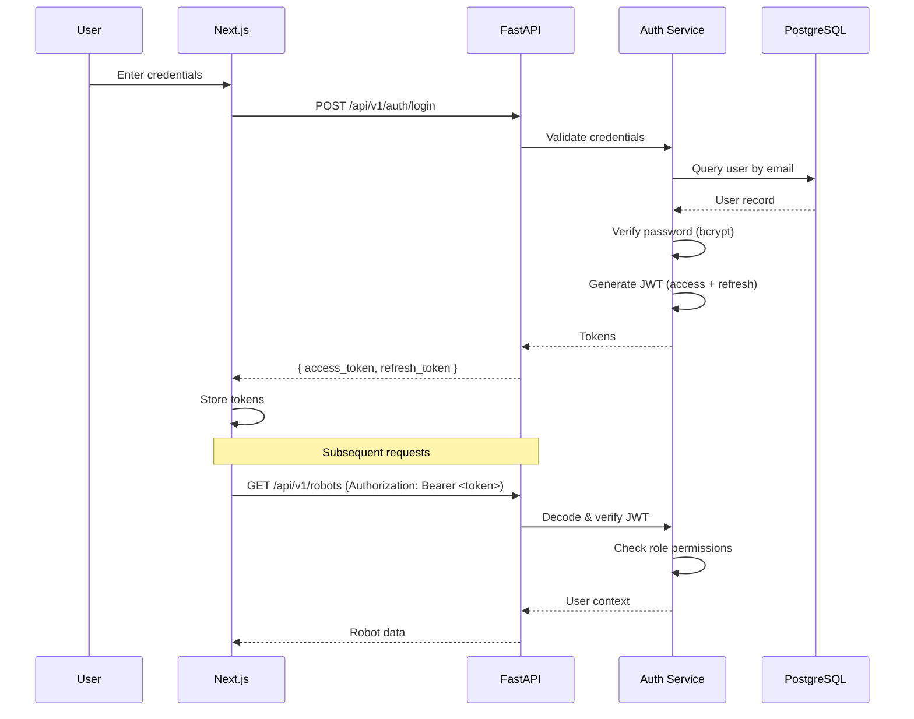
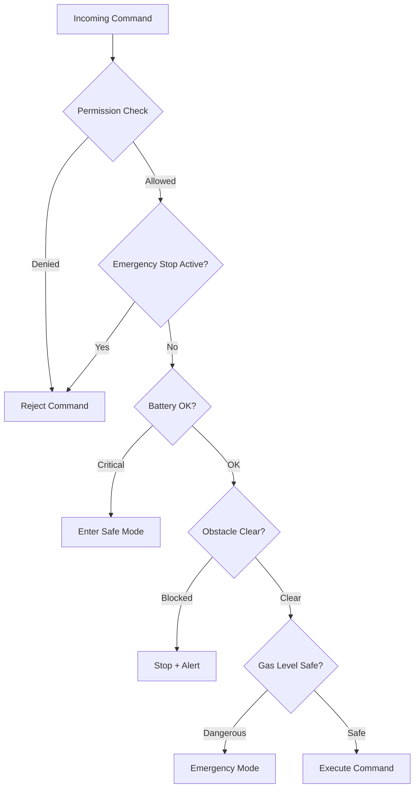
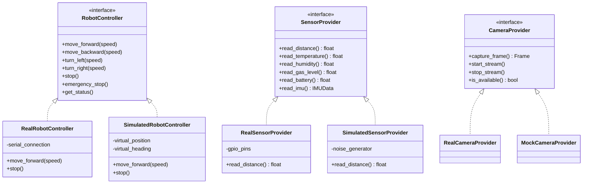

# AURA — System Architecture

## 1. Architecture Overview

AURA follows a **layered clean architecture** with clear separation between presentation, business logic, data access, and IoT communication layers.

### Core Architecture Principle

```
PERCEIVE → UNDERSTAND → REASON → DECIDE → ACT → OBSERVE → LEARN → REPEAT
```

The robot operates as an **intelligent edge device**, not a simple remote-controlled vehicle. Local safety logic runs independently of cloud connectivity.

---

## 2. High-Level System Architecture



---

## 3. Component Architecture



---

## 4. Deployment Architecture



---

## 5. Data Flow Architecture

### 5.1 Telemetry Flow



### 5.2 Command Flow



### 5.3 Alert Generation Flow



---

## 6. Authentication & Authorization Flow



---

## 7. MQTT Topic Architecture

```
robot/
├── {robot_id}/
│   ├── telemetry      # Sensor data (robot → backend)
│   ├── command         # Control commands (backend → robot)
│   ├── status          # Robot status updates (robot → backend)
│   ├── sensor          # Raw sensor readings (robot → backend)
│   ├── alert           # Robot-generated alerts (robot → backend)
│   ├── heartbeat       # Liveness signal (robot → backend)
│   ├── detection       # AI detection events (robot → backend)
│   ├── navigation      # Navigation updates (bidirectional)
│   └── system          # System events (bidirectional)
```

### Message Direction

| Topic | Direction | QoS |
|-------|-----------|-----|
| `telemetry` | Robot → Backend | 0 (at most once) |
| `command` | Backend → Robot | 1 (at least once) |
| `status` | Robot → Backend | 1 (at least once) |
| `heartbeat` | Robot → Backend | 0 (at most once) |
| `alert` | Robot → Backend | 2 (exactly once) |
| `detection` | Robot → Backend | 1 (at least once) |

---

## 8. Safety Architecture

Safety operates at two levels:

### Edge-Level Safety (Raspberry Pi)
- Runs locally, independent of cloud
- Obstacle detection → immediate stop
- Gas detection → emergency mode
- Battery critical → safe mode
- Communication timeout → stop and wait

### Backend-Level Safety
- Command validation before MQTT publish
- Permission checking (RBAC)
- Emergency stop override
- Alert generation and notification



---

## 9. Hardware Abstraction



---

## 10. Scalability Design

### Per-Robot Isolation

- Each robot has dedicated MQTT topics (`robot/{id}/*`)
- Telemetry stored with `robot_id` foreign key + index
- WebSocket channels per robot (`/ws/robots/{id}`)
- Commands routed by robot ID

### Scaling Strategy

| Scale | Approach |
|-------|----------|
| 1 robot | Single Docker Compose |
| 10 robots | Same infra, connection pooling |
| 100 robots | Separate MQTT topics, async processing, read replicas |
| 1000+ robots | Microservices, message queues, time-series DB |

---

## 11. Technology Decisions

| Decision | Choice | Rationale |
|----------|--------|-----------|
| Backend Framework | FastAPI | Async-native, auto OpenAPI docs, Pydantic integration |
| Database | PostgreSQL | ACID, JSON support, proven at scale |
| ORM | SQLAlchemy 2.0 | Async support, mature ecosystem |
| IoT Protocol | MQTT | Lightweight, pub/sub, perfect for IoT |
| Frontend | Next.js 14 | SSR, app router, TypeScript, React ecosystem |
| Auth | JWT | Stateless, scalable, standard |
| AI/CV | YOLOv8 + OpenCV | Real-time detection, edge-deployable |
| Containerization | Docker Compose | Simple multi-service orchestration |

---

## 12. Directory Structure Rationale

```
backend/
├── app/
│   ├── api/          # HTTP route handlers (thin controllers)
│   ├── models/       # SQLAlchemy ORM models (data layer)
│   ├── schemas/      # Pydantic request/response models (validation)
│   ├── services/     # Business logic (domain layer)
│   ├── ai/           # AI/ML services (isolated concern)
│   └── core/         # Cross-cutting: config, security, logging, exceptions
```

This follows the **Repository/Service pattern**:
- **API layer** handles HTTP concerns only
- **Service layer** contains all business logic
- **Model layer** handles database mapping
- **Schema layer** handles validation and serialization
- Dependencies flow inward: API → Service → Model
