# AURA — Database Documentation

## Overview

AURA uses **PostgreSQL 16** as its primary relational database, accessed via **SQLAlchemy 2.0** (async mode with `asyncpg`) and managed with **Alembic** migrations.

## Entity-Relationship Diagram

```mermaid
erDiagram
    USERS {
        uuid id PK
        varchar name
        varchar email UK
        text password_hash
        enum role
        boolean is_active
        timestamp created_at
        timestamp updated_at
        timestamp last_login
    }

    ROBOTS {
        uuid id PK
        varchar name
        varchar device_id UK
        varchar serial_number UK
        enum status
        enum mode
        float battery
        varchar firmware_version
        varchar ip_address
        timestamp last_seen
        float home_x
        float home_y
        timestamp created_at
        timestamp updated_at
    }

    TELEMETRY {
        uuid id PK
        uuid robot_id FK
        float temperature
        float humidity
        float gas_level
        float distance
        float battery
        float speed
        float cpu_usage
        float memory_usage
        timestamp timestamp
    }

    SENSOR_READINGS {
        uuid id PK
        uuid robot_id FK
        varchar sensor_type
        float value
        varchar unit
        timestamp timestamp
    }

    ALERTS {
        uuid id PK
        uuid robot_id FK
        enum type
        enum severity
        varchar title
        text message
        enum status
        varchar source
        timestamp created_at
        timestamp acknowledged_at
        uuid acknowledged_by FK
    }

    ROBOT_COMMANDS {
        uuid id PK
        uuid robot_id FK
        uuid issued_by FK
        enum command
        jsonb parameters
        enum status
        varchar source
        timestamp issued_at
        timestamp executed_at
    }

    DETECTIONS {
        uuid id PK
        uuid robot_id FK
        varchar object_type
        float confidence
        jsonb bounding_box
        varchar image_path
        timestamp timestamp
    }

    AI_EVENTS {
        uuid id PK
        uuid robot_id FK
        varchar event_type
        varchar source
        text description
        jsonb data
        timestamp timestamp
    }

    PATROL_ROUTES {
        uuid id PK
        varchar name
        text description
        integer is_active
        timestamp created_at
        timestamp updated_at
    }

    PATROL_POINTS {
        uuid id PK
        uuid route_id FK
        varchar name
        float x
        float y
        integer sequence_order
        integer dwell_time_seconds
    }

    PATROL_SESSIONS {
        uuid id PK
        uuid robot_id FK
        uuid route_id FK
        enum status
        timestamp started_at
        timestamp completed_at
        integer points_visited
        float distance_covered
        float battery_consumed
    }

    SYSTEM_LOGS {
        uuid id PK
        varchar level
        varchar source
        text message
        jsonb metadata_json
        timestamp timestamp
    }

    AUDIT_LOGS {
        uuid id PK
        uuid user_id FK
        varchar action
        varchar resource_type
        uuid resource_id
        jsonb details
        varchar ip_address
        timestamp timestamp
    }

    NOTIFICATIONS {
        uuid id PK
        uuid user_id FK
        enum type
        varchar title
        text message
        boolean is_read
        jsonb data
        timestamp created_at
    }

    MAINTENANCE_RECORDS {
        uuid id PK
        uuid robot_id FK
        varchar type
        text description
        varchar performed_by
        jsonb parts_replaced
        timestamp completed_at
        timestamp created_at
    }

    LOCATIONS {
        uuid id PK
        varchar name UK
        text description
        float x
        float y
        varchar floor
        varchar zone
        timestamp created_at
    }

    USERS ||--o{ ROBOT_COMMANDS : "issues"
    USERS ||--o{ AUDIT_LOGS : "generates"
    USERS ||--o{ ALERTS : "acknowledges"
    ROBOTS ||--o{ TELEMETRY : "produces"
    ROBOTS ||--o{ SENSOR_READINGS : "produces"
    ROBOTS ||--o{ ALERTS : "triggers"
    ROBOTS ||--o{ ROBOT_COMMANDS : "receives"
    ROBOTS ||--o{ DETECTIONS : "generates"
    ROBOTS ||--o{ PATROL_SESSIONS : "executes"
    ROBOTS ||--o{ MAINTENANCE_RECORDS : "has"
    PATROL_ROUTES ||--o{ PATROL_POINTS : "contains"
    PATROL_ROUTES ||--o{ PATROL_SESSIONS : "used_by"
```



## Tables Summary

| Table | Purpose | Key Indexes |
|-------|---------|-------------|
| `users` | User accounts + RBAC | `email` (unique) |
| `robots` | Robot device registry | `device_id` (unique), `serial_number` (unique) |
| `telemetry` | Aggregated sensor snapshots | `(robot_id, timestamp)` composite |
| `sensor_readings` | Individual sensor values | `(robot_id, sensor_type, timestamp)` composite |
| `alerts` | Anomaly/system alerts | `(robot_id, created_at)`, `(status, severity)` |
| `robot_commands` | Command audit trail | `(robot_id, issued_at)` |
| `detections` | AI object detections | `(robot_id, timestamp)`, `object_type` |
| `ai_events` | AI service event log | `(event_type, timestamp)` |
| `patrol_routes` | Named patrol routes | — |
| `patrol_points` | Ordered waypoints | `(route_id, sequence_order)` |
| `patrol_sessions` | Patrol execution records | `(robot_id, started_at)` |
| `system_logs` | Application event log | `(level, timestamp)`, `source` |
| `audit_logs` | User action audit trail | `(user_id, timestamp)`, `action` |
| `notifications` | User notifications | `user_id`, `created_at` |
| `maintenance_records` | Robot service history | `(robot_id, created_at)` |
| `locations` | Named environment locations | `name` (unique) |

## Migrations

```bash
# Generate a new migration
cd backend
alembic revision --autogenerate -m "description"

# Apply migrations
alembic upgrade head

# Rollback one step
alembic downgrade -1
```
