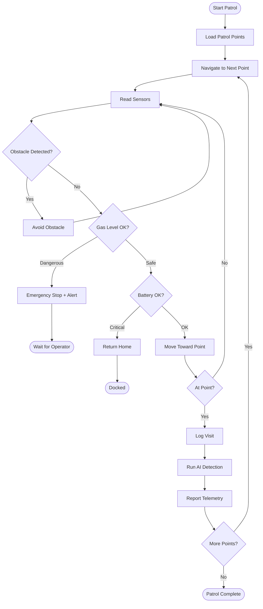
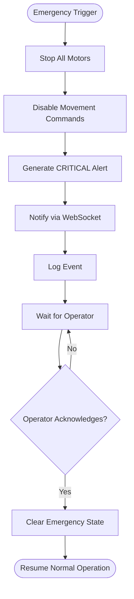

# AURA — Software Requirements Specification (SRS)

**Version:** 1.0
**Date:** 2026-10-05
**Project:** AURA — Autonomous Unified Robotic Assistant

---

## 1. Introduction

### 1.1 Purpose

This document specifies the software requirements for the AURA AIoT Autonomous Robotics Platform. It serves as the primary reference for development, testing, and validation.

### 1.2 Scope

AURA is an AI-powered IoT autonomous mobile robot platform for security and surveillance. The system enables robots to patrol indoor environments, detect anomalies, stream video with AI object detection, and report events to operators through a real-time web dashboard.

### 1.3 Definitions

| Term | Definition |
|------|-----------|
| **AIoT** | Artificial Intelligence of Things |
| **MQTT** | Message Queuing Telemetry Transport |
| **RBAC** | Role-Based Access Control |
| **SLAM** | Simultaneous Localization and Mapping |
| **Telemetry** | Automated measurement and transmission of data |
| **Edge Device** | Computing device at the network edge (robot) |
| **Heartbeat** | Periodic signal indicating device is alive |

---

## 2. Overall Description

### 2.1 Product Perspective

AURA is a standalone platform consisting of:
- Web-based dashboard (Next.js)
- Backend API server (FastAPI)
- IoT message broker (MQTT/Mosquitto)
- Relational database (PostgreSQL)
- Physical or simulated robot(s)
- AI/computer vision engine

### 2.2 Product Functions

1. Robot fleet management and monitoring
2. Real-time telemetry collection and visualization
3. Manual and autonomous robot control
4. AI-powered object detection (YOLO)
5. Sensor anomaly detection and alerting
6. Natural-language robot command interface
7. Autonomous patrol with obstacle avoidance
8. Emergency safety controls
9. Role-based access control
10. Historical analytics and reporting

### 2.3 User Classes

| Role | Description | Permissions |
|------|-------------|-------------|
| **Admin** | System administrator | Full access: users, robots, config, telemetry, alerts, audit |
| **Operator** | Robot operator | View data, control robots, manage patrols, acknowledge alerts |
| **Viewer** | Read-only observer | View status, telemetry, camera, alerts, analytics |

### 2.4 Operating Environment

- **Server:** Linux (Docker containers)
- **Edge:** Raspberry Pi OS, ESP32 (FreeRTOS/Arduino)
- **Client:** Modern web browser (Chrome, Firefox, Edge, Safari)
- **Network:** TCP/IP, MQTT, WebSocket, HTTP/HTTPS

### 2.5 Constraints

- Real-time telemetry requires network connectivity
- AI inference limited by edge compute resources
- Physical robot requires specific hardware components
- Software simulator provided for hardware-free operation

---

## 3. Functional Requirements

### 3.1 Authentication & Authorization

| ID | Requirement | Priority |
|----|-------------|----------|
| FR-AUTH-01 | System shall support user registration with email/password | High |
| FR-AUTH-02 | System shall authenticate users via JWT tokens | High |
| FR-AUTH-03 | System shall support token refresh | High |
| FR-AUTH-04 | System shall enforce RBAC (Admin, Operator, Viewer) | High |
| FR-AUTH-05 | System shall hash passwords using bcrypt | High |
| FR-AUTH-06 | System shall log all authentication events | Medium |
| FR-AUTH-07 | Admin shall be able to create, update, and delete users | High |

### 3.2 Robot Management

| ID | Requirement | Priority |
|----|-------------|----------|
| FR-ROBOT-01 | System shall support registering multiple robots | High |
| FR-ROBOT-02 | System shall track robot status (ONLINE/OFFLINE) | High |
| FR-ROBOT-03 | System shall detect robot offline via heartbeat timeout | High |
| FR-ROBOT-04 | System shall support robot modes: MANUAL, AUTONOMOUS, RETURN_HOME, EMERGENCY | High |
| FR-ROBOT-05 | System shall store robot metadata (name, serial, firmware, IP) | Medium |
| FR-ROBOT-06 | System shall support 1–100+ robots concurrently | Medium |

### 3.3 Telemetry

| ID | Requirement | Priority |
|----|-------------|----------|
| FR-TEL-01 | Robot shall publish telemetry via MQTT | High |
| FR-TEL-02 | Backend shall validate and store telemetry in PostgreSQL | High |
| FR-TEL-03 | Dashboard shall display real-time telemetry via WebSocket | High |
| FR-TEL-04 | System shall support historical telemetry queries (1h, 6h, 24h, 7d, 30d) | Medium |
| FR-TEL-05 | Telemetry shall include: battery, temperature, humidity, gas, distance, speed, CPU, memory | High |
| FR-TEL-06 | System shall reject malformed telemetry messages | High |

### 3.4 Robot Control

| ID | Requirement | Priority |
|----|-------------|----------|
| FR-CMD-01 | Operator/Admin shall send movement commands via API | High |
| FR-CMD-02 | Commands: MOVE_FORWARD, MOVE_BACKWARD, TURN_LEFT, TURN_RIGHT, ROTATE_LEFT, ROTATE_RIGHT, STOP | High |
| FR-CMD-03 | Commands: START_PATROL, STOP_PATROL, RETURN_HOME, EMERGENCY_STOP, SET_SPEED | High |
| FR-CMD-04 | All commands shall pass safety validation | High |
| FR-CMD-05 | Viewer role shall not be able to send commands | High |
| FR-CMD-06 | Emergency stop shall override all other commands | Critical |

### 3.5 Safety

| ID | Requirement | Priority |
|----|-------------|----------|
| FR-SAFE-01 | Emergency stop shall reject all movement commands | Critical |
| FR-SAFE-02 | Robot shall stop if obstacle < minimum safe distance | Critical |
| FR-SAFE-03 | Robot shall enter safe mode if battery < critical threshold | Critical |
| FR-SAFE-04 | Robot shall stop on communication timeout | Critical |
| FR-SAFE-05 | Robot shall stop and alert if gas > critical threshold | Critical |
| FR-SAFE-06 | Safety logic shall operate without Internet connectivity | Critical |

### 3.6 Alerts

| ID | Requirement | Priority |
|----|-------------|----------|
| FR-ALERT-01 | System shall generate alerts for anomalous sensor readings | High |
| FR-ALERT-02 | Alerts shall have severity: INFO, WARNING, CRITICAL | High |
| FR-ALERT-03 | Alerts shall be displayed in real-time on dashboard | High |
| FR-ALERT-04 | Operator/Admin shall acknowledge alerts | High |
| FR-ALERT-05 | System shall support alert filtering and search | Medium |

### 3.7 AI / Computer Vision

| ID | Requirement | Priority |
|----|-------------|----------|
| FR-AI-01 | System shall detect objects using YOLO (person, vehicle, animal, bag, obstacle) | High |
| FR-AI-02 | Each detection shall include: type, confidence, bounding box, timestamp | High |
| FR-AI-03 | Detection events shall be stored and displayed | High |
| FR-AI-04 | System shall support anomaly detection via configurable thresholds | High |
| FR-AI-05 | System shall support natural-language command interpretation | Medium |
| FR-AI-06 | AI commands shall pass through validation, permission, and safety checks | High |

### 3.8 Patrol

| ID | Requirement | Priority |
|----|-------------|----------|
| FR-PAT-01 | Admin shall define patrol routes with waypoints | High |
| FR-PAT-02 | Robot shall follow patrol route autonomously | High |
| FR-PAT-03 | System shall track patrol sessions (start, end, points visited, alerts, detections) | High |
| FR-PAT-04 | Robot shall avoid obstacles during patrol | High |
| FR-PAT-05 | Patrol history shall be viewable in dashboard | Medium |

### 3.9 Analytics

| ID | Requirement | Priority |
|----|-------------|----------|
| FR-ANA-01 | System shall display robot uptime statistics | Medium |
| FR-ANA-02 | System shall show battery consumption trends | Medium |
| FR-ANA-03 | System shall show alert frequency charts | Medium |
| FR-ANA-04 | System shall show detection frequency | Medium |
| FR-ANA-05 | System shall calculate robot health score (0–100) | Medium |

### 3.10 Simulator

| ID | Requirement | Priority |
|----|-------------|----------|
| FR-SIM-01 | Simulator shall emulate robot behavior without hardware | High |
| FR-SIM-02 | Simulator shall communicate via MQTT (same protocol as real robot) | High |
| FR-SIM-03 | Simulator shall support modes: NORMAL, LOW_BATTERY, OBSTACLE, HIGH_GAS, etc. | High |
| FR-SIM-04 | Simulator shall generate realistic telemetry with noise | Medium |
| FR-SIM-05 | Demo mode shall run a scripted scenario for demonstrations | Medium |

---

## 4. Non-Functional Requirements

### 4.1 Performance

| ID | Requirement |
|----|-------------|
| NFR-PERF-01 | API response time < 500ms for standard requests |
| NFR-PERF-02 | WebSocket updates within 100ms of telemetry receipt |
| NFR-PERF-03 | MQTT message processing shall be asynchronous |
| NFR-PERF-04 | Database queries shall use appropriate indexes |

### 4.2 Security

| ID | Requirement |
|----|-------------|
| NFR-SEC-01 | All passwords stored as bcrypt hashes |
| NFR-SEC-02 | JWT tokens with configurable expiration |
| NFR-SEC-03 | CORS restricted to allowed origins |
| NFR-SEC-04 | Rate limiting on authentication endpoints |
| NFR-SEC-05 | No secrets committed to version control |
| NFR-SEC-06 | HTTPS-ready configuration |
| NFR-SEC-07 | MQTT authentication enabled |

### 4.3 Reliability

| ID | Requirement |
|----|-------------|
| NFR-REL-01 | Robot shall operate safely during network failure |
| NFR-REL-02 | System shall detect and report service health degradation |
| NFR-REL-03 | Critical telemetry buffered locally during disconnection |

### 4.4 Scalability

| ID | Requirement |
|----|-------------|
| NFR-SCALE-01 | Architecture supports 1–100+ concurrent robots |
| NFR-SCALE-02 | Per-robot MQTT topic isolation |
| NFR-SCALE-03 | Database designed for time-series telemetry at scale |

### 4.5 Maintainability

| ID | Requirement |
|----|-------------|
| NFR-MAINT-01 | Clean architecture with separation of concerns |
| NFR-MAINT-02 | Comprehensive automated test suite |
| NFR-MAINT-03 | Complete technical documentation |
| NFR-MAINT-04 | Docker-based deployment |
| NFR-MAINT-05 | CI/CD pipeline |

---

## 5. Use Case Diagram

```mermaid
graph TB
    subgraph Actors
        ADMIN((Admin))
        OPERATOR((Operator))
        VIEWER((Viewer))
        ROBOT((Robot))
        SIMULATOR((Simulator))
    end

    subgraph "Authentication"
        UC_LOGIN[Login]
        UC_REGISTER[Register User]
        UC_MANAGE_USERS[Manage Users]
    end

    subgraph "Robot Management"
        UC_VIEW_ROBOTS[View Robots]
        UC_ADD_ROBOT[Add Robot]
        UC_CONTROL[Control Robot]
        UC_ESTOP[Emergency Stop]
        UC_VIEW_STATUS[View Status]
    end

    subgraph "Monitoring"
        UC_VIEW_TELEM[View Telemetry]
        UC_VIEW_CAMERA[View Camera]
        UC_VIEW_ALERTS[View Alerts]
        UC_ACK_ALERT[Acknowledge Alert]
        UC_ANALYTICS[View Analytics]
    end

    subgraph "Patrol"
        UC_START_PATROL[Start Patrol]
        UC_STOP_PATROL[Stop Patrol]
        UC_DEFINE_ROUTE[Define Route]
    end

    subgraph "AI"
        UC_DETECT[Object Detection]
        UC_ANOMALY[Anomaly Detection]
        UC_NL_CMD[NL Command]
    end

    subgraph "System"
        UC_SEND_TELEM[Send Telemetry]
        UC_HEARTBEAT[Send Heartbeat]
        UC_EXEC_CMD[Execute Command]
    end

    ADMIN --> UC_LOGIN
    ADMIN --> UC_REGISTER
    ADMIN --> UC_MANAGE_USERS
    ADMIN --> UC_ADD_ROBOT
    ADMIN --> UC_CONTROL
    ADMIN --> UC_ESTOP
    ADMIN --> UC_VIEW_TELEM
    ADMIN --> UC_VIEW_ALERTS
    ADMIN --> UC_ACK_ALERT
    ADMIN --> UC_ANALYTICS
    ADMIN --> UC_DEFINE_ROUTE
    ADMIN --> UC_START_PATROL
    ADMIN --> UC_NL_CMD

    OPERATOR --> UC_LOGIN
    OPERATOR --> UC_VIEW_ROBOTS
    OPERATOR --> UC_CONTROL
    OPERATOR --> UC_ESTOP
    OPERATOR --> UC_VIEW_TELEM
    OPERATOR --> UC_VIEW_CAMERA
    OPERATOR --> UC_VIEW_ALERTS
    OPERATOR --> UC_ACK_ALERT
    OPERATOR --> UC_ANALYTICS
    OPERATOR --> UC_START_PATROL
    OPERATOR --> UC_STOP_PATROL
    OPERATOR --> UC_NL_CMD

    VIEWER --> UC_LOGIN
    VIEWER --> UC_VIEW_ROBOTS
    VIEWER --> UC_VIEW_STATUS
    VIEWER --> UC_VIEW_TELEM
    VIEWER --> UC_VIEW_CAMERA
    VIEWER --> UC_VIEW_ALERTS
    VIEWER --> UC_ANALYTICS

    ROBOT --> UC_SEND_TELEM
    ROBOT --> UC_HEARTBEAT
    ROBOT --> UC_EXEC_CMD
    ROBOT --> UC_DETECT
    ROBOT --> UC_ANOMALY

    SIMULATOR --> UC_SEND_TELEM
    SIMULATOR --> UC_HEARTBEAT
    SIMULATOR --> UC_EXEC_CMD
```

---

## 6. Activity Diagrams

### 6.1 Autonomous Patrol Activity

### 6.2 Emergency Stop Activity

---

## 7. Acceptance Criteria

The system is complete when:

- [ ] Frontend runs and displays dashboard
- [ ] Backend runs and serves API
- [ ] PostgreSQL stores all data correctly
- [ ] MQTT broker handles robot communication
- [ ] Robot simulator generates realistic telemetry
- [ ] Real-time updates appear on dashboard via WebSocket
- [ ] Manual robot control works
- [ ] Autonomous patrol works in simulation
- [ ] Emergency stop works
- [ ] Alerts are generated and displayed
- [ ] Authentication and RBAC work
- [ ] AI detection works (or simulated)
- [ ] Offline safety works
- [ ] Tests pass
- [ ] Docker Compose starts all services
- [ ] Documentation is complete
