# AURA — UML Diagrams

## 1. Class Diagram — Core Domain Model

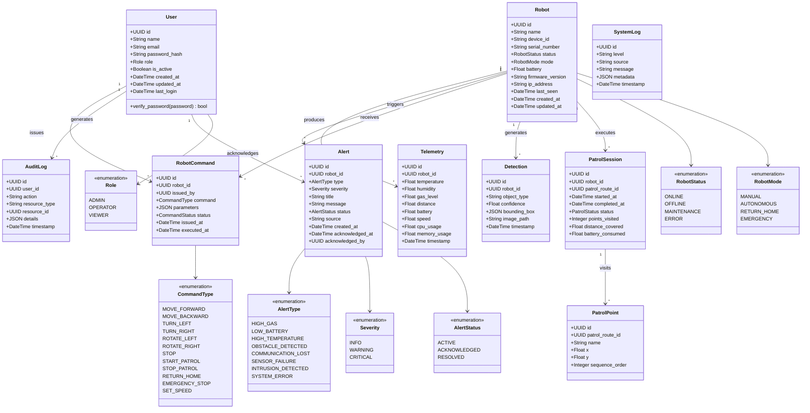

---

## 2. Sequence Diagram — User Login

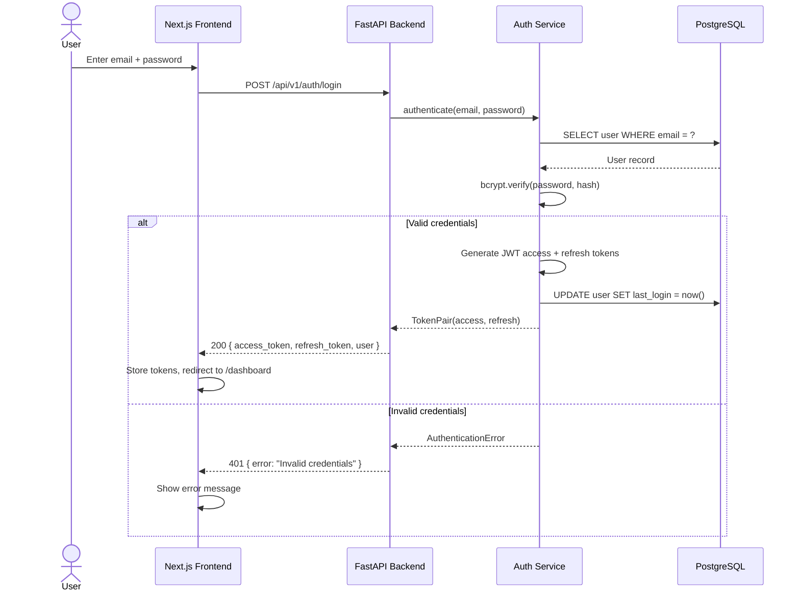

---

## 3. Sequence Diagram — Manual Robot Command

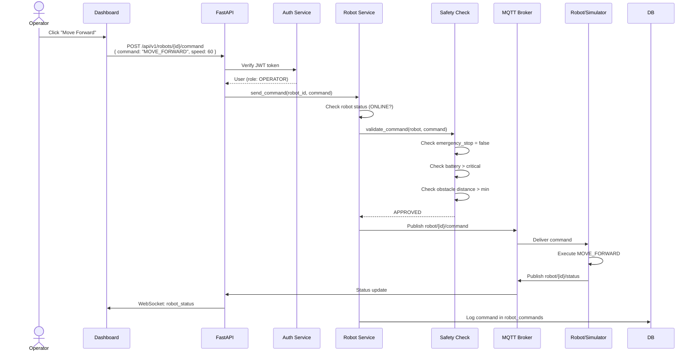

---

## 4. Sequence Diagram — Telemetry Flow

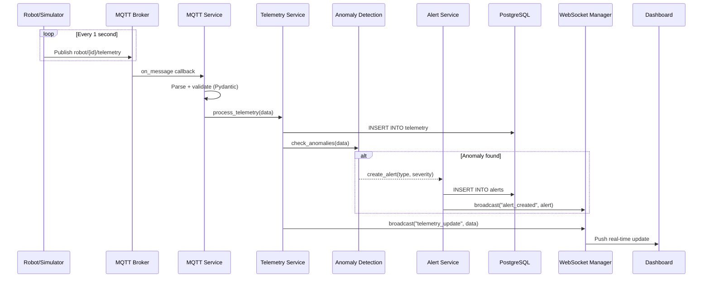

---

## 5. Sequence Diagram — Alert Generation

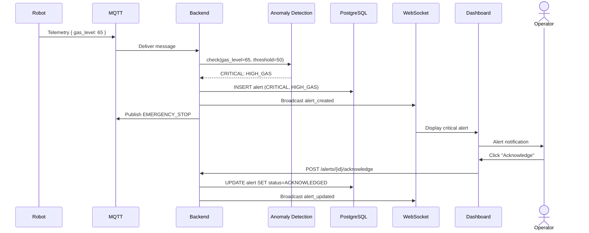

---

## 6. Sequence Diagram — AI Object Detection

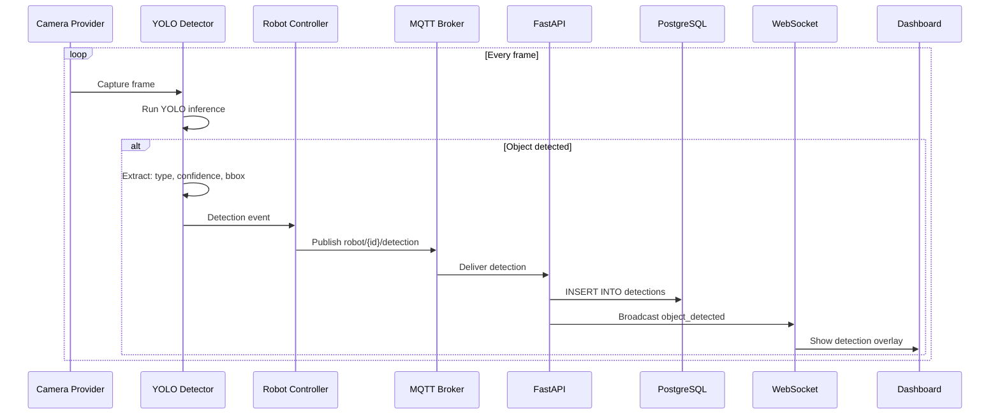

---

## 7. Sequence Diagram — Autonomous Patrol

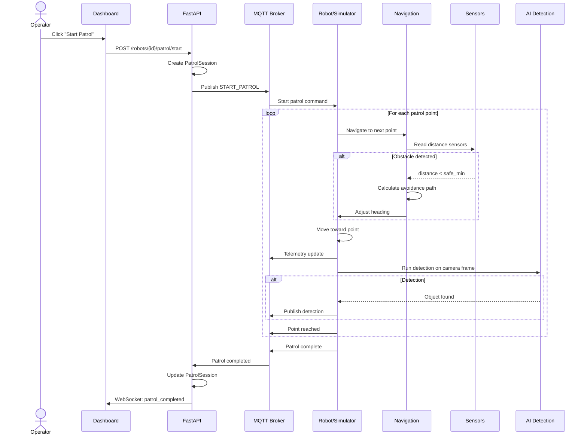

---

## 8. Sequence Diagram — Emergency Stop

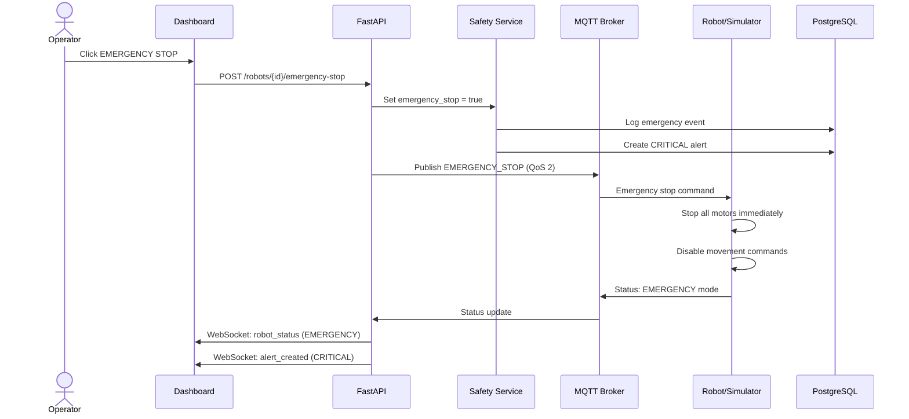

---

## 9. Sequence Diagram — Network Failure & Recovery

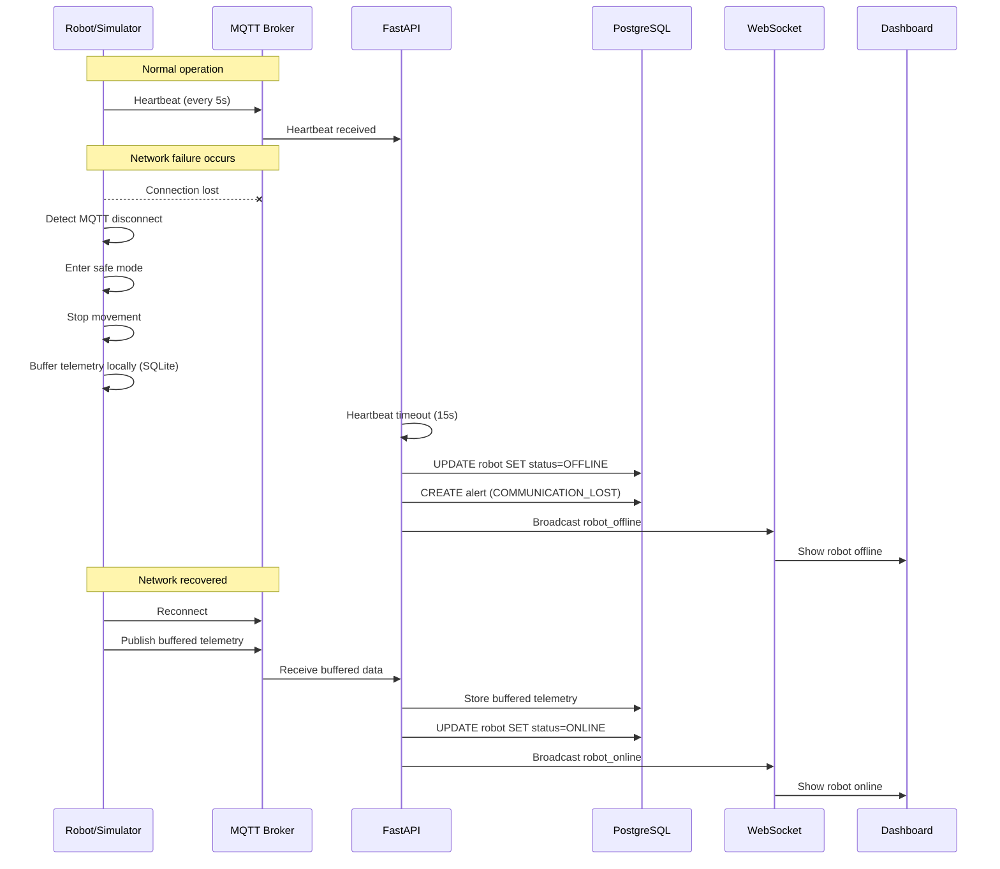

---

## 10. Sequence Diagram — AI Natural-Language Command

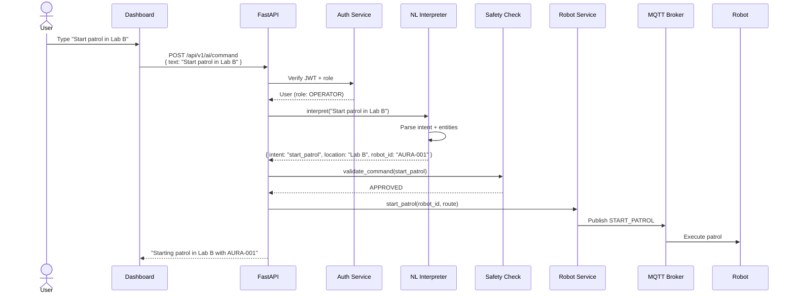

---

## 11. Sequence Diagram — Robot Reconnection

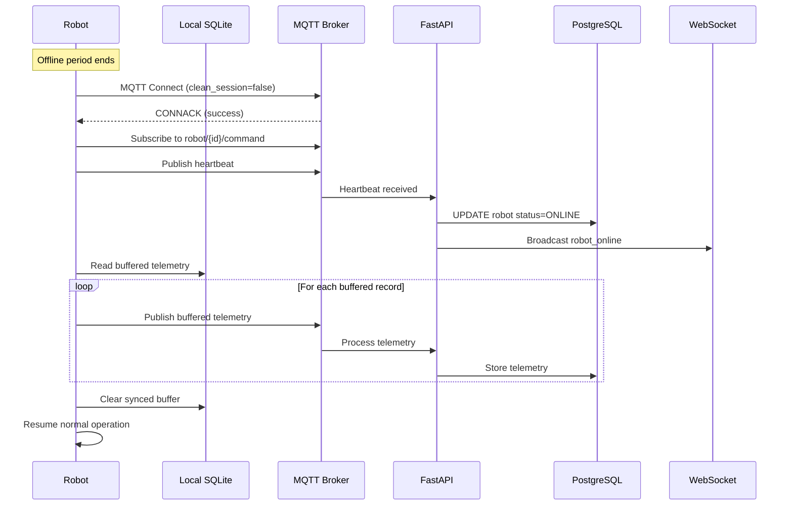

---

## 12. Component Diagram

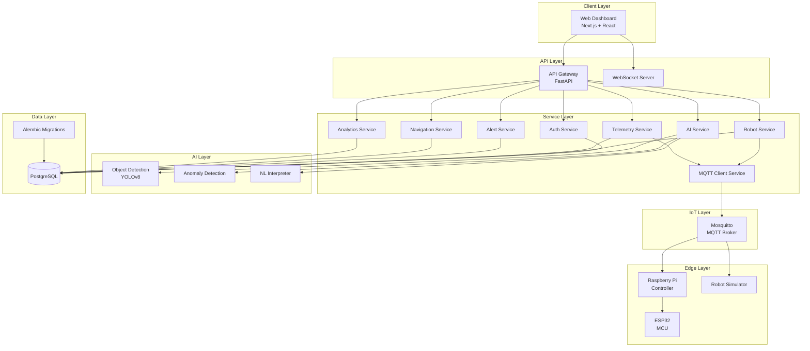

---

## 13. Deployment Diagram

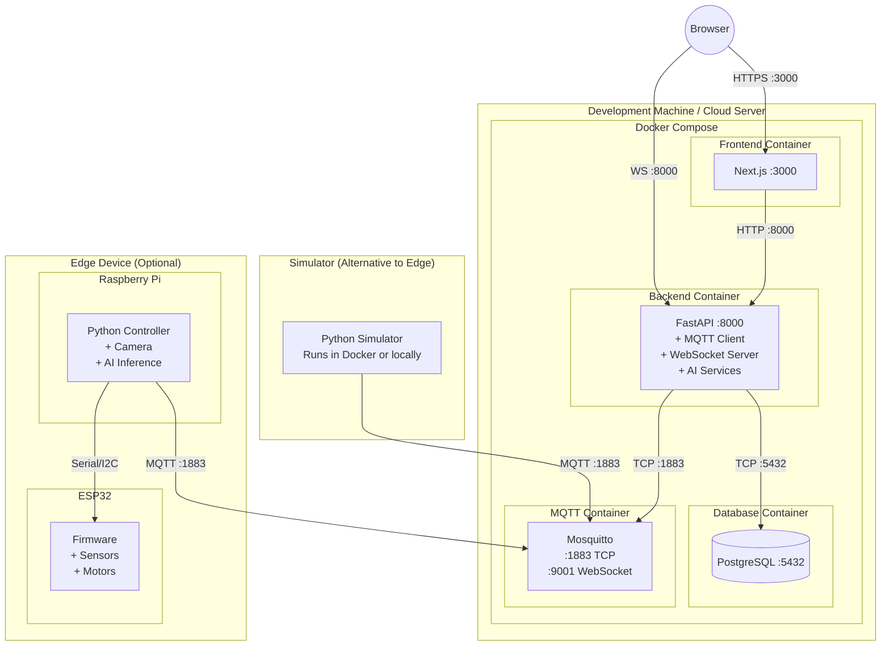
